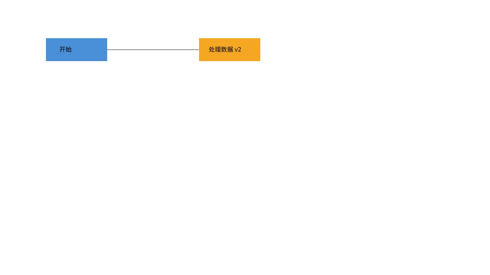
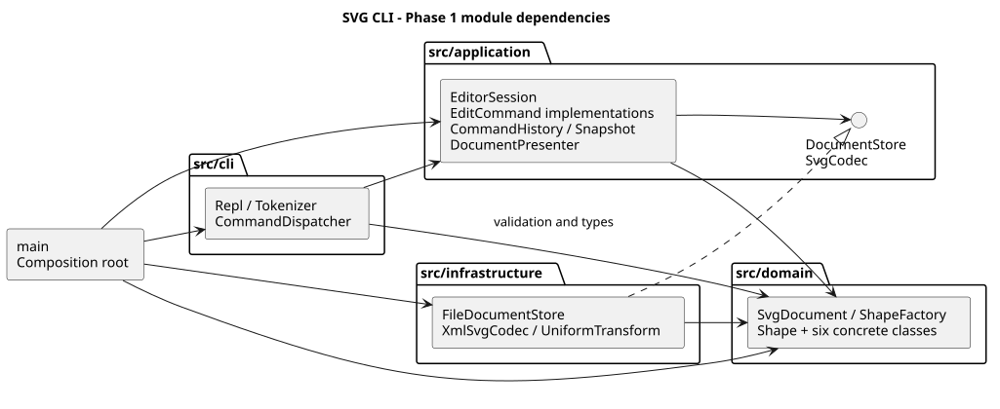

# Lab1 Phase 1：SVG 编辑器 CLI

**Git 仓库：[https://github.com/Iwanttriumph/svg-editor-cli](https://github.com/Iwanttriumph/svg-editor-cli)**

最终提交标签：[final](https://github.com/Iwanttriumph/svg-editor-cli/tree/final) · [开发提交历史](https://github.com/Iwanttriumph/svg-editor-cli/commits/main) · [自动验证](https://github.com/Iwanttriumph/svg-editor-cli/actions)

本项目依据仓库中的 `phase_cli_1.md` 完成，实现 TypeScript 面向对象的 SVG 命令行编辑器。支持 `rect / circle / ellipse / line / text / g` 六种内置类型，以及全部 Phase 1 命令。`box` 和插件加载属于后续阶段。

## 使用与功能

环境：Node.js 22 或更高版本、npm。本机验证环境为 Windows、Node.js 22.12.0；依赖版本由 `package-lock.json` 固定。

```sh
git clone https://github.com/Iwanttriumph/svg-editor-cli.git
cd svg-editor-cli
npm ci
npm run cli
```

交互终端显示 `svg>` 提示符，输入 `help` 查看语法。结束输入或按 Ctrl+C 退出。标准输入重定向时不输出交互提示符，便于回放脚本。

```text
init 800 600
create g scene
create rect r1 10 20 100 50 #4a90d9 in scene
create text t1 30 50 "开始" in scene
move scene 40 20
undo
redo
tree
show r1
save demo.svg
```

PowerShell 回放示例：

```powershell
Get-Content -Encoding UTF8 examples/flowchart.commands | npm run cli
Get-Content -Encoding UTF8 examples/typical.commands | npm run cli
```

Linux/macOS 可使用 `npm run cli < examples/flowchart.commands`。生成的 SVG 可直接拖入浏览器。

| 类别 | 命令 |
| --- | --- |
| 文档 | `init [w] [h]`、`read <file.svg>`、`save [file.svg]`、`canvas [w] [h]` |
| 编辑 | `create`、`delete`、`move`、`scale`、`set`、`group`、`ungroup`、`addto`、`front`、`back` |
| 显示 | `tree [id]`、`show <id>`、`help` |
| 历史 | `undo`、`redo` |

`create` 的几何参数和 `set` 白名单遵循作业说明。只有整行首个非空白字符为 `#` 才视为注释，因此 `#4a90d9` 颜色不会被截断。带空格的内容与路径用双引号，支持 `\"` 和 `\\` 转义。引号中的 `"in"` 是文本，只有未加引号的尾缀 `in <containerId>` 表示父容器。

浏览器中的实际预览截图，来自 `examples/flowchart.svg`：



## 架构方案

### 1. 模块划分与职责

| 模块 | 职责与代表类 |
| --- | --- |
| `src/domain` | `Shape` 抽象与六种具体图形；`SvgDocument` 管理组合树、ID、父子关系、顺序和画布；`ShapeFactory` 集中创建图形 |
| `src/application` | `EditorSession` 管理当前文档及路径；`CommandHistory` 管理编辑历史；`DocumentSnapshot` 封装快照；`DocumentPresenter` 输出树和属性 |
| `src/application/commands` | 十个编辑命令类，每条命令实现 `EditCommand`，只处理对应的领域操作 |
| `src/application/ports` | `DocumentStore` 定义异步读写接口；`SvgCodec` 定义编解码接口，成功读入返回文档和警告 |
| `src/cli` | `Tokenizer` 解析引号；`CommandDispatcher` 注册语法、校验参数并构造命令；`Repl` 负责终端输入输出 |
| `src/infrastructure` | `XmlSvgCodec` 负责 XML 与领域对象转换；`UniformTransform` 处理受支持变换；`FileDocumentStore` 实现文件读写 |
| `src/main.ts` | 组装工厂、编解码器、存储、会话与 REPL，是唯一同时认识所有具体实现的入口 |
| `tests` / `examples` / `doc` | 自动测试、回放案例与 SVG、提交文档及图示 |

PlantUML 组件图如下，箭头表示源码依赖方向；虚线表示接口实现。图与可修改的 [PlantUML 源文件](architecture.puml) 一并提交。



### 2. 设计模式的选择与落地

**Command（必选）**：`EditCommand.execute(document)` 是统一接口。Create、Delete、Move、Scale、Set、Group、Ungroup、AddTo、Front、Back 分别有独立的 Command 类。CLI 只构造并提交命令，不直接修改图形字段。一次 `group` 即使改动多个父容器，也只产生一个历史单元。

**Memento**：`DocumentSnapshot` 内部保存深拷贝，恢复时再次克隆，不向外暴露历史文档。历史管理器先复制当前文档，让 Command 在候选文档上执行；全部成功后才加入前后快照并替换当前文档。因此操作中途失败不会污染当前树、撤销栈或重做栈。重做恢复成功执行后的快照，无须重新触发 IO。该方案易于确认正确性，代价是每次编辑需要 O(N) 级别的复制与历史存储，适合本阶段规模。

**Composite**：`Group` 与五种叶子图形均继承 `Shape`，提供 `move / scale / setAttribute / clone` 等操作。`Group.move` 和 `Group.scale` 递归委托给子节点。编辑命令无需按图形类型分支，删除容器自然删除整棵子树。

**Factory**：`ShapeFactory` 集中保存六种类型的创建规则和几何字段，CLI 创建与 SVG 导入复用同一入口。复制、显示、移动、缩放和保存通过对象接口完成。

两个名称分派点是 `CommandDispatcher` 的命令注册表和 `ShapeFactory` 的类型注册表。**两处均为后续插件阶段的待重构点**：当前仍内置注册，尚未实现动态加载或新增类型时“内核零改动”。

### 3. 依赖方向规则

| 来源模块 | 允许依赖 | 理由 |
| --- | --- | --- |
| domain | domain | 领域行为独立于交互方式、文件格式和 IO |
| application | application、domain | 组织用例，通过自身定义的端口使用存储能力 |
| cli | cli、application、domain | 构造应用命令，复用领域校验、错误和工厂类型，不接触具体存储实现 |
| infrastructure | infrastructure、application、domain | 实现应用层端口，完成外部数据与领域对象转换 |
| main | 以上所有模块 | 集中进行依赖组装 |

`node:readline` 和终端流位于 CLI 边界；文件系统、路径和 XML 库位于 infrastructure。domain 与 application 不允许导入 Node 内置模块或第三方库；application 不允许导入 CLI 或 infrastructure；CLI 不允许导入 infrastructure。违反规则应作为待处理项，不能通过修改文档掩盖。

### 4. 变化点假设

| 未来变化 | 当前预留与未实现部分 |
| --- | --- |
| 增加图形或 `box` 插件 | 工厂集中注册、图形多态接口和组合树可复用；后续仍须设计 ShapeProvider、插件注册和 data-kind 还原，不提前构造插件框架 |
| 加入 GUI / agent 入口 | 可复用 EditorSession 与 Command；终端解析、显示已分开，领域模型中不保存提示符或 stdin |
| 远程存储或其他持久化格式 | DocumentStore / SvgCodec 已隔离 IO；新增适配器并在 main 中替换，不让领域模型学习文件 API |
| 大文档与更长历史 | 可用命令差量替换全量快照，或增加历史上限；本阶段优先可验证的原子性，不提前实现复杂增量机制 |
| 完整 SVG / CSS / 任意变换 | XML 逻辑集中在基础设施层；本阶段支持明确子集，不模拟完整浏览器引擎 |

## 过程记录

以下为实际开发中发生的决策与修正，不是事后虚构的人工审查或讨论。

| 阶段 / 提交 | 发现、确认与处理 |
| --- | --- |
| `1809281` 工程与初始架构 | 目录最初只有作业说明。确认完整实现，文档放在 doc/README.md；本机 Git 与连接器账号不同，按用户选择使用 Iwanttriumph 创建公开仓库 |
| `2d1d673` 领域模型 | 完成多态图形与组合文档后运行首批 3 项测试。实际安装的 TypeScript 7 未自动引入 Node 类型，编译报 node:test 类型缺失；显式配置 types: ["node"]，重新验证通过 |
| `e854a3f` Command 与历史 | 为落实失败不改变状态的约定，采用候选副本执行、成功后提交。用含 1e308 坐标的组合图形制造缩放中途溢出，确认此前子图形、文档及 redo 均不受失败影响；累计 6 项测试通过 |
| `4485171` SVG IO 与 CLI | 单遍补号可能与后续显式 ID 冲突，因此先预扫描保留全部 ID。保留 token 的 quoted 标志，避免文本 "in" 被当成父容器语法；实现真实文件 IO 与编译后 REPL 回放，累计 14 项测试通过 |
| `4a6dd4c` 验证与边界修正 | 检查发现 JavaScript Number 会接受 0x10 等非 SVG 十进制写法，加入数值词法限制；避免把组 opacity 错当可继承样式，明确拒绝该未支持属性。补充各类几何运算、跨父级分组和架构检查，累计 17 项测试通过 |
| 最终文档阶段（final） | 从锁文件重新执行 npm ci 并通过测试；回放两段作业会话。远程浏览器预览超时后，使用本地 HTTP 预览成功检查图形、连线和中文标签，保存截图；将初始方案补全为与实现一致的文档及 PlantUML 图 |

### 语义解释与方案修订

- `group` 不按参数顺序重排图形。跨父级时按原文档前序遍历排列，新组放在首个被选节点原父容器、原位置；禁止同时选择祖先与后代。这是对说明未完全定义行为的补充。
- `front` 移至同级最后一个节点，`back` 移至第一个节点，符合后绘制覆盖先绘制的 SVG 语义。
- 文档命令只有成功后才清空历史并禁止 undo/redo。`canvas` 无参为查询，不触发屏障；help/tree/show 不入栈。下一次成功编辑解禁；失败编辑不清空 redo。
- `init [w] [h]` 支持分别省略可选参数，默认 800×600。画布尺寸和 scale factor 必须为有限正数；图形尺寸、半径及 stroke-width 允许 0，不允许负数。
- `save` 无参使用最近一次成功读入或保存的路径；新文档未指定路径时明确报错。init 清空旧路径。写入采用同目录临时文件再重命名，失败清理临时文件。
- 初始方案只概述 CLI 依赖应用层；实际 CLI 还复用领域校验与工厂类型，最终规则和图中明确列出该允许方向，不允许直接引用基础设施。
- 导入的 translate 和正向等比 scale 按 SVG 变换顺序折算到叶子坐标；必要时折算 stroke-width 和 text 的数值 font-size。之后普通编辑 scale 按作业要求只缩放几何属性。
- ungroup 提升子节点时补齐原容器提供、且子节点未显式覆盖的受支持样式；后续分组或移动归属遵循当前 SVG 树的继承关系。

## 一致性自查

**1. 实际模块划分是否与方案一致？** 一致。初始四层和组装入口均已落地，commands 与 ports 为应用层内部细分。终端交互、用例、领域行为、XML/文件 IO 分别有独立职责。CLI 对 domain 的辅助依赖已记入修订。架构测试检查生产源码中每个类独立文件、文件名等于类名。

**2. 依赖方向是否违反规则？** 扫描所有生产源码的静态 import，按上表检查，当前未发现违规；测试同时检查没有按 tag/type 的 switch 分派。抽样核查如下：

- `MoveCommand → SvgDocument / Shape.move`：通过多态移动，不依赖终端或 XML。
- `EditorSession → DocumentStore`：依赖端口，没有引用 FileDocumentStore。
- `XmlSvgCodec → SvgCodec / ShapeFactory / SvgDocument`：基础设施实现接口并转换模型，领域层无反向引用。
- `main → FileDocumentStore / XmlSvgCodec / EditorSession / Repl`：具体实现只在入口组装。

该检查针对当前静态 import，不声称覆盖尚未存在的动态插件依赖。运行 `npm test` 可重复检查。

## 质量保证手段

### 可重复验证

```sh
npm ci
npm run check
npm test
```

`npm test` 先执行严格 TypeScript 编译，再用 Node.js 内置测试框架运行测试。Windows 本机从锁文件重装后的结果为 **17 项通过，0 失败，0 跳过**。GitHub Actions 在 Windows 与 Ubuntu、Node.js 22 上分别执行 npm ci 和 npm test，[实现验证运行](https://github.com/Iwanttriumph/svg-editor-cli/actions/runs/39390203068)的两个系统任务均成功。最终文档提交后的运行可在 [Actions 页面](https://github.com/Iwanttriumph/svg-editor-cli/actions)查看。

| 验证范围 | 检查内容 |
| --- | --- |
| 工程架构 | 模块允许依赖、一类一文件、文件命名、无 tag/type switch |
| 六类图形 | 各几何字段移动与缩放、样式白名单、文本、深拷贝、有限数与非负约束 |
| 组合树 | 唯一且大小写敏感的 ID、创建归属、祖先后代约束、分组顺序、跨父级移动、解组与同级顺序 |
| Command / 历史 | 十个编辑命令逐个检查执行、撤销、重做前后的树；中途失败回滚；IO 屏障、失败 IO 不清历史、新编辑清 redo |
| 参数与错误 | 注释与颜色、引号与空文本、中文、Windows 路径、缺文档、重复 ID、缺目标、非容器、未知类型/属性、非法 scale |
| SVG 读写 | 六种类型及层级往返、XML 转义、自动 ID 冲突、嵌套变换、错误 XML 与不支持内容拒绝 |
| 实际 IO / CLI | 临时目录中真实保存和覆盖、读写失败、临时文件清理；子进程回放流程图，检查退出状态、输出、保存与重新读取 |

此外，实际回放 `examples/typical.commands`：容器包含后代时报错、保存后 undo 被禁止、外部文件补 rect1 警告均符合说明。在实际交互终端中确认了 svg> 提示符、连续输入和撤销后的属性。回放 flowchart.commands 保存后，在浏览器中检查颜色、坐标、连线和中文；截图见本文开头。这是基本显示检查，不等于像素级回归测试。

### 已知限制与阶段边界

- 本阶段六种图形以外，不包含 box、动态插件、GUI 或完整 SVG 规范。
- SVG 导入接受六种元素及基本几何字段、fill/stroke/stroke-width、font-size/font-family/font-weight/text-anchor、fill-opacity/stroke-opacity。根画布支持数值或 px 尺寸；viewBox 必须为 0 0 width height 且与画布相同。
- 变换只支持 translate 和正向等比 scale；旋转、矩阵、非等比/负数缩放、CSS style、group opacity、path、tspan、外部引用和 DOCTYPE 等明确拒绝。XML 注释和格式空白不作为内容保存；字体外观依赖浏览器字体。
- 不宣称兼容任意第三方 SVG，也未实现插件类型 data-kind 的还原/降级逻辑。
- 撤销重做反馈为 undone:/redone: 加原操作摘要，tree/show 使用完整属性名，与示例排版略有差异；实际状态和规定错误字符串由测试检查。
- 历史使用内存全量快照，无容量上限，适用于课程小规模文档。
- 截止时间未提供，不作“已在截止时间前完成”的声明；可通过远程提交历史与 final 标签核验实际提交。

### 参考与工具

- 功能及提交要求：仓库根目录 `phase_cli_1.md`。
- XML 库：[@xmldom/xmldom 官方说明](https://github.com/xmldom/xmldom)。
- 架构图：PlantUML 组件图，使用[官方文本编码方式](https://plantuml.com/text-encoding)生成静态 SVG，阅读文档不需要本地 Java。
- 协作工具：Codex；浏览器目视验证使用 computer-use 技能。过程记录仅描述实际完成的检查。
